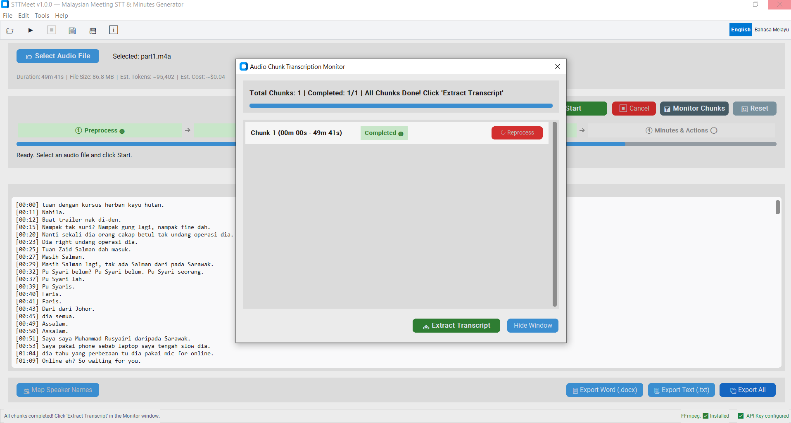

# STTMeet

[](https://github.com/terranoss/STTMeet/actions/workflows/tests.yml)
[](LICENSE)
[](https://github.com/terranoss/STTMeet)
[](https://www.python.org/)

**High-performance meeting transcription and synthesis for the Malaysian workplace.**

STTMeet turns a long, recorded meeting into a clean timestamped transcript, formatted minutes, an executive recap and an action item register - on your desktop, without re-typing a word.

It is built specifically for **Bahasa Melayu mixed with English ("Bahasa Rojak")**, the code-switched way Malaysian business and government meetings are actually conducted. Global transcription tools routinely mangle this; STTMeet is tuned for it.

---

## Contents

- [Download](#download)
- [Screenshot](#screenshot)
- [Why STTMeet?](#why-sttmeet)
- [How it works](#how-it-works)
- [Models and failover](#models-and-failover)
- [Cost estimation](#cost-estimation)
- [Quick start](#quick-start)
- [Using the app](#using-the-app)
- [Recording your meeting](#recording-your-meeting)
- [Choosing a minute template](#choosing-a-minute-template)
- [Building the Windows installer](#building-the-windows-installer)
- [Project structure](#project-structure)
- [Where your data lives](#where-your-data-lives)
- [Privacy and data](#privacy-and-data)
- [Running unit tests](#running-unit-tests)
- [Troubleshooting](#troubleshooting)
- [FAQ](#faq)
- [Contributing](#contributing)
- [Changelog](#changelog)
- [License](#license)

---

## Download

[](https://github.com/terranoss/STTMeet/releases/latest/download/sttmeet_setup.exe) [](https://github.com/terranoss/STTMeet/releases)

[Direct Download (`sttmeet_setup.exe`)](https://github.com/terranoss/STTMeet/releases/latest/download/sttmeet_setup.exe) &nbsp;•&nbsp; [All Releases & Changelog](https://github.com/terranoss/STTMeet/releases)

| | |
| :--- | :--- |
| **Platform** | Windows 10 / 11 (x64) |
| **Version** | 1.1.0 |
| **You must install** | Nothing - Python, all dependencies and FFmpeg are bundled |
| **You must bring** | A free or paid [Gemini API key](https://aistudio.google.com/apikey) |

>  **The installer is not code-signed**, so Windows SmartScreen will show a blue "Windows protected your PC" warning on first run. Click **More info** → **Run anyway**. This is expected for an unsigned community build, not a sign of a problem.

You can also [run from source](#quick-start) if you'd rather not install anything.

---

## Screenshot



*The main window: Windows-style menu bar and toolbar, the four-step pipeline (① Preprocess → ② Chunking → ③ Transcribe → ④ Minutes & Actions), the chunk monitor for per-chunk status and recovery, and a status bar that always shows FFmpeg and API key readiness.*

---
## Why STTMeet?

### Built for Bahasa Rojak
Most speech models are trained on one language at a time and fall apart when a sentence switches mid-clause. STTMeet keeps speech in the exact language it was spoken (Bahasa Melayu + English), retaining Malaysian conversational particles - *lah, kan, kot, je, tau, meh, lor, ya, wei, eh* - and normalising spoken contractions into readable forms (*"tak leh"* → *"tak boleh"*, *"camne"* → *"macam mana"*, *"dorang"* → *"diorang"*). Malaysian acronyms survive intact: *KPI, SOP, PBT, MOF, KWSP, EPF, SSM, LHDN, HRDF, JKR*. Disfluencies (*"uhm"*, *"err"*, stuttering) are cleaned out while clear spoken statements are kept.

### Built for 4-hour+ meetings
Committee sessions, board meetings and full-day workshops are the normal case, not the edge case. Silence-based chunking with a 5-second overlap keeps continuity across boundaries, and a chunk manifest means switching engines never re-slices your audio. Checkpoints are written as chunks complete, so a dropped connection or an app restart resumes from the last completed chunk - you never re-transcribe what you already paid for.

### Survives exhausted quotas
Free-tier Gemini quotas fill up fast. In **Auto-Failover** mode STTMeet automatically moves down the fallback chain when a model returns `429 / RESOURCE_EXHAUSTED`, so a rate-limit error doesn't end a two-hour job. Transient errors (`503`, network blips) are retried with backoff on the same model first. You can also pin a specific model for consistent output.

### Four documents from one recording
You never re-transcribe to get a different document. Each output is generated independently from the transcript already in the workspace, and each can be retried on its own.

| Output | What it gives you |
| :--- | :--- |
| **Transcript** | Full timestamped text with continuous timeline offsets |
| **Speaker mapping** | `Speaker 1` → `En. Ahmad`, applied across transcript and minutes |
| **Minutes** | Four templates: Action, Discussion (Topical), Three-Column, Board/Governance |
| **Executive Recap** | TL;DR, decisions, deliverables, strategic topics, risks |
| **Action Items** | Task, PIC, deadline, status matrix |

### Exports that are actually presentable
- **Word (`.docx`)** - headings, styled tables and real bold/italic Word formatting. Markdown tables become genuine Word tables; `**bold**` becomes actual bold text, not asterisks.
- **Plain Text (`.txt`)** - fully stripped of Markdown syntax. Headings, tables and lists are converted to clean plain text; no `##`, `**`, or `|` ever reach the file.
- The Minutes export appends the full transcript as an appendix, so the record and its evidence ship as one document.
- Exported titles, labels and date month names follow the interface language (English or Bahasa Melayu), while filename prefixes stay stable across language switches so your files never get renamed under you.

### Bilingual interface
Switch between **English** and **Bahasa Melayu** from the toolbar toggle - instantly, with no restart. The choice drives the output language too: minutes, recap and action items are generated in the matching language, and the  output chip always shows which language generation will use.

### Privacy-first by design
Your API key stays in a local `.env` and is never written to a session file. Audio is uploaded one chunk at a time and each chunk is deleted from Google's cloud storage immediately after transcription. Everything else - pre-processed audio, per-chunk transcripts, checkpoints, sessions - stays in `.sttmeet_cache/` on your machine.

### A real Windows desktop app
No browser tabs, no drag-and-drop web uploaders, no subscription. STTMeet is a native-feeling desktop app with a menu bar, toolbar, status bar and an in-app offline documentation reader - and it keeps working for session review and exports when you're offline (only transcription and generation need the network).

---
## How it works

1. **Smart pre-processing.** FFmpeg converts your audio to 16kHz mono MP3 at 64kbps, shrinking a file by **80–90%** for roughly 10x faster uploads, with no loss of speech intelligibility. The pre-processed copy is cached, so re-runs skip the conversion entirely.
2. **Hybrid silence-based chunking.** Audio is split on natural silence rather than blindly by duration: the cutter targets your chosen chunk length, then scans forward up to 2 minutes for a pause (≥ 500 ms at −40 dBFS) to make the cut, with a 5-second overlap so no sentence is lost on a boundary. If no pause is found, it falls back to a cut at the edge of the scan window. The chunk manifest is cached alongside your session.
3. **Transcription.** Chunks upload to the Gemini Files API one at a time, each with the previous chunk's closing lines passed in for speaker-label consistency. Transcript generation runs with `max_output_tokens=65536` and temperature `0.1` so long chunks never truncate mid-sentence. Completed chunk text is checkpointed to disk as it finishes.
4. **Synthesis.** Minutes, recap and action items are generated from the finished transcript using a lighter Flash model to conserve quota - never from re-uploaded audio.
5. **Cloud hygiene.** Each chunk is deleted from cloud storage as soon as it has been transcribed (best-effort cleanup that never masks the original error).

Supported input: `.mp3` `.m4a` `.wav` `.aac` `.ogg` `.flac` `.mp4`

### Default pipeline parameters

| Parameter | Default | Notes |
| :--- | :--- | :--- |
| Chunk length | 25 min | Choices: No Chunking / 15 / 20 / 25 / 30 / 45 min |
| Silence scan window | 2 min past target | Searches forward for a natural pause |
| Silence threshold | −40 dBFS | Pauses ≥ 500 ms qualify as cut points |
| Chunk overlap | 5 s | Preserves sentence continuity across boundaries |
| Pre-process format | 16 kHz mono MP3, 64 kbps | 80–90% smaller than typical recordings |
| Output token cap | 65,536 | Prevents mid-sentence truncation |
| Temperature | 0.1 | Deterministic, consistent transcripts |

These are defined in [`src/config.py`](src/config.py) if you run from source and want to tune them.

---

## Models and failover

STTMeet talks to the [Google Gemini API](https://ai.google.dev/gemini-api) through the official `google-genai` SDK.

**Engine choices** (Settings → Engine):

| Engine | Model(s) | Best for |
| :--- | :--- | :--- |
| **Gemini Cloud (Auto-Failover)** *(recommended)* | `gemini-3.8-flash` → `gemini-3.5-flash` → `gemini-3.5-flash-lite` | Long jobs on free-tier quotas |
| Gemini 3.8 Flash | `gemini-3.8-flash` | Highest accuracy, pinned |
| Gemini 3.5 Flash | `gemini-3.5-flash` | Balanced, pinned |
| Gemini 3.5 Flash Lite | `gemini-3.5-flash-lite` | Cheapest/fastest, pinned |

**How failover works:**

- Each chunk is transcribed with retries: transient errors (`503`, network) back off and retry on the *same* model first.
- A `429 / RESOURCE_EXHAUSTED / quota exceeded` response immediately promotes the job to the **next model in the chain** - your two-hour job keeps running instead of dying on a rate limit.
- If one model exhausts its retries, the job falls over to the next candidate automatically.
- Only when *every* model in the chain fails does STTMeet surface an error telling you to wait for quota reset or switch API key.
- Cancellation is respected everywhere, including during retry backoff.

**Synthesis models.** Minutes, recap and action items run on `gemini-3.5-flash-lite` first (fallback: `gemini-3.8-flash` → `gemini-3.5-flash`) - a deliberate choice to keep document generation cheap while transcription gets the stronger model.

**Speaker ID (diarization)** requires **No Chunking** mode and a standard Flash model; it is disabled for Flash Lite and for chunked audio (the model isn't reliable at speaker labels across chunk boundaries in those configurations). The in-app hint recommends No Chunking for meetings under 60–90 minutes.

---

## Cost estimation

Before you press Start, the app shows **estimated tokens and estimated cost** for your selected file (audio tokens ≈ 32 per second of audio, output ≈ 3.5 tokens per second of speech).

| Meeting length | Est. input tokens | Est. total cost (paid tier) |
| :--- | :--- | :--- |
| 1 hour | ~115,000 | ~$0.05 |
| 2 hours | ~230,000 | ~$0.11 |
| 4 hours | ~461,000 | ~$0.21 |

*Estimates use published Gemini Flash rates ($0.35/1M input, $1.05/1M output) and exclude synthesis, which adds only a few thousand tokens per document. On the free tier your cost is $0 - you pay in quota, which is exactly why failover and chunk checkpointing exist. Treat these as guidance only; check [Google's pricing](https://ai.google.dev/pricing) for current rates.*

---
## Quick start

### Option A - Install the app (recommended)

1. Download `sttmeet_setup.exe` from the [Download](#-download) section above.
2. Run it. SmartScreen will warn - see the note there.
3. Launch **STTMeet** from your Start menu.

### Option B - Run from source

**Prerequisites:** Python 3.10+ (tested on 3.12) and FFmpeg on your `PATH`.

```powershell
git clone https://github.com/terranoss/STTMeet.git
cd STTMeet
pip install -r requirements.txt
python main.py
```

Optional: copy `.env.example` to `.env` and set `GEMINI_API_KEY=...` - though you can also paste the key in the app's Settings dialog and it will be written to `.env` for you.

Verify FFmpeg with `ffmpeg -version`. If you don't have it, install it with `winget install Gyan.FFmpeg` or grab a build from [gyan.dev](https://www.gyan.dev/ffmpeg/builds/). (The installer bundles FFmpeg, so this step only applies to source runs.)

---

## Using the app

The window follows familiar Windows conventions: a **menu bar** (File / Edit / Tools / Help), an **icon toolbar** (Open, Start, Cancel, Save, Docs, About) with an **EN / Bahasa Melayu** toggle on the right, a four-step pipeline in the middle, tabs for the four outputs, and a **status bar** that always shows FFmpeg and API key readiness.

1. **Add your API key.** Open **Tools → Settings...**, paste your Gemini API key and click **Save**. The status bar shows a green **API Key configured** badge (and **FFmpeg  Installed** next to it). Get a key at [Google AI Studio](https://aistudio.google.com/apikey).
2. **Select audio.** Click **File → Open Audio...** or the  toolbar button. The app shows total duration, file size, and estimated input tokens/cost.
3. **Pick your options.** An **Audio Setup Wizard** appears with recommended settings for your file (dismissable, and re-openable any time via **Tools → Setup Wizard...**):
   - **Engine** - **Gemini Cloud (Auto-Failover)** (recommended), or pin one model.
   - **Chunk length** - No Chunking (Single File - enables Speaker ID) / 15 / 20 / **25 (recommended)** / 30 / 45 minutes.
   - **Pre-process (16kHz Mono)** - checked by default for ~10x faster uploads.
   - **Minutes format** and **language** - remembered between sessions.
4. **Start.** Hit **▶ Start** (or the toolbar ▶) and watch the step badges progress: **① Preprocess → ② Chunking → ③ Transcribe → ④ Minutes & Actions**. Open **Monitor Chunks** for per-chunk status (`pending` / `working` / `done` / `error`); **↻ Reprocess** retries a single failed chunk, and **Extract Transcript** pulls completed chunks into the workspace - even from a partial run. **Cancel** stops cleanly; completed chunks stay checkpointed.
5. **Generate documents.** Each tab generates independently from the transcript in the workspace:
   - **Minit Mesyuarat / Minutes** → pick a template → **Generate Minutes** (results are cached per template, so switching templates doesn't re-bill you)
   - **Rekap Mesyuarat / Meeting Recap** → **Generate Recap**
   - **Senarai Tindakan / Action Items** → **Generate Action Items**
6. **Map speakers.** Choose **Edit → Map Speaker Names...** (or the  button) to replace `Speaker 1` with real names. Do this *before* generating minutes - the generator reads from the transcript, so corrected names flow into every downstream document. Requires No Chunking mode (see [Models and failover](#-models-and-failover)).
7. **Export.** Click **Export Word (.docx)**, **Export Text (.txt)**, or **Export All** for the active tab. The Minutes export appends the full transcript as an appendix.
8. **Save and resume.** **Save** (toolbar or File → Save Session) stores your settings, progress and output; the app also autosaves as chunks complete, on cancel, on speaker mapping and on close. Re-select the same audio file to restore the workspace exactly as you left it. **File → Reset Workspace** (or  Reset) clears everything.
9. **Switch language anytime.** The **English / Bahasa Melayu** toggle in the toolbar relabels the entire UI *and* sets the output language for generated documents - no restart.

Full details live in the in-app reader: **Tools → Documentation** or the  **Docs** toolbar button (works fully offline).

---

## Recording your meeting

STTMeet accepts recordings from any platform. The in-app user guide (**Docs → User Guide**) has step-by-step capture instructions for each:

| Source | Where the file comes from |
| :--- | :--- |
| **Zoom** | Record → *Record on this Computer*; find `audio_only.m4a` under `Documents\Zoom\...` |
| **Microsoft Teams** | *More (⋯)* → *Record and transcribe* → download from the channel Files or organizer's OneDrive |
| **Google Meet** | *Activities → Recording* (Workspace plan); download the `.mp4` from Drive - STTMeet extracts the audio |
| **In person** | Windows Sound Recorder, a phone voice memo, or a conference mic - place the mic centrally |

**Tips for clean transcripts:**

- Ask speakers to **announce their name** when taking the floor (*"This is Sarah, on item 3..."*) - it gives the model (and speaker mapping) anchors.
- Keep **Pre-process (16kHz Mono)** on; it normalises levels as well as shrinking the file.
- Damp vibrations: record on a notepad/mousepad, avoid table tapping and paper rustling.
- For Zoom, enabling *high-fidelity audio music mode* and softening noise suppression helps muffled voices.

---
## Choosing a minute template

The **Minutes** tab's **Meeting Minute Format** dropdown decides the structure of the generated document. Your choice is remembered between sessions, and generated minutes are cached per template so you can compare formats without paying twice.

| Template | Structure | Best for |
| :--- | :--- | :--- |
| **Action Minutes** *(default)* | Objective, review of prior action items, agenda decisions, action item register table, next meeting | Weekly ops syncs, standups, project updates - decisions and ownership |
| **Discussion (Topical)** | Per-topic deliberation records - arguments, alternatives considered, agreement - then a decisions summary | Strategy committees, policy task forces, workshops where *reasoning* matters |
| **Three-Column** | One row per item: *Discussion & Deliberation* · *Action Required & Decision* · *Responsibility & Deadline* | Execution-focused meetings: site coordination, vendor reviews, dense agendas |
| **Board / Governance** | Call to order & quorum, approvals, numbered resolutions, voting records, declarations of interest, signatures | Formal governing bodies: board meetings, AGMs, statutory compliance |

A fifth output - the **Executive Recap** - is a separate tab, not a minutes template: a one-page brief (TL;DR, key decisions, deliverables, strategic topics, risks, open items) for people who will never read the full minutes.

**Reading the template fields:**

- Square brackets like `[Owner]` are placeholders the generator fills from the transcript. If the meeting never names an owner, the field stays generic - review it before circulating.
- Every action needs three things: **what**, **who**, and **by when**. If the meeting agreed on the *what* but not the *who*, add the owner yourself afterwards.
- Metadata (title, date, chairperson, attendees, apologies) is parsed from what was said; state these at the top of the meeting for best results.

The full description of each format lives in the in-app docs (**Docs → Meeting Minute Formats**) and in [`docs/meeting_minute/`](docs/meeting_minute/).

---
## Building the Windows installer

```powershell
.\scripts\build_windows.cmd
```

This creates a virtualenv, downloads FFmpeg into `vendor\ffmpeg\bin\`, freezes the app with [PyInstaller](https://pyinstaller.org/) into `sttmeet.dist\`, and compiles **`installer_output\sttmeet_setup.exe`** with [Inno Setup 6](https://jrsoftware.org/isinfo.php).

Build machine requirements: Python 3.10+, `assets\app_icon.ico`, and Inno Setup 6. Nothing else - FFmpeg and all Python dependencies are bundled, and end users install nothing.

To attach the result to the download link at the top of this README, tag a release and upload the installer:

```powershell
git tag v1.0.0
git push origin v1.0.0
# then upload installer_output\sttmeet_setup.exe to the GitHub release
```

Installed builds write data to `%LOCALAPPDATA%\STTMeet` (`.env`, `sttmeet.log`, `.sttmeet_cache\`) because `C:\Program Files` isn't user-writable. The `docs/` folder is bundled so **Tools → Documentation** works entirely offline.

Useful flags for `build_windows.ps1`:

| Flag | Effect |
| :--- | :--- |
| `-InstallerOnly` | Skip the freeze step; package an existing `sttmeet.dist\` into the installer |
| `-SkipInstaller` | Freeze only; don't compile the Inno Setup installer |
| `-UpdateDeps` | Force-reinstall Python dependencies even if they look up to date |
| `-UpdateFfmpeg` | Re-download the bundled FFmpeg build even if present |

Run `Get-Help .\scripts\build_windows.ps1 -Full` for the remaining switches (`-OneFile`, `-UseGcc`).

---

## Project structure

```text
STTMeet/
├── main.py                     # Application entry point with launch notifications
├── requirements.txt            # Python dependencies (google-genai, customtkinter, python-docx, ...)
├── .env.example                # Template for GEMINI_API_KEY
├── .gitignore                  # Ignores caches, .env, audio, temp chunks
├── .gitattributes              # Line-ending normalization (LF) & binary declarations
├── LICENSE                     # MIT License
├── SECURITY.md                 # Vulnerability reporting & secret-handling guidance
├── CHANGELOG.md                # Release history (Keep a Changelog format)
├── test_pipeline.py            # Unit tests for logic, post-processing, i18n & session store
├── sttmeet.spec                # PyInstaller bundle specification
│
├── assets/
│   ├── app_icon.ico            # Application + installer icon
│   └── img1.png                # README screenshot
│
├── scripts/
│   ├── build_windows.cmd       # One-command Windows installer build
│   ├── build_windows.ps1       # PyInstaller freeze + FFmpeg fetch + Inno Setup compile
│   └── sttmeet_setup.iss       # Inno Setup 6 installer definition
│
├── docs/                       # Read in-app via Tools →  Documentation
│   ├── user_guide.md           # End-to-end guide: recording, workflow, template selection, troubleshooting
│   ├── executive_meeting_recap_template.md
│   └── meeting_minute/
│       ├── template_descp.txt  # In-app format descriptions
│       └── *_template.md       # Prompt specs for developers (not shown in-app)
│
├── .github/
│   ├── workflows/tests.yml     # CI: unit tests on Python 3.10 & 3.12 (windows-latest)
│   └── ISSUE_TEMPLATE/         # Bug report & feature request forms
│
├── src/
│   ├── __init__.py
│   ├── version.py              # Application version (single source of truth for builds)
│   ├── config.py               # Settings manager (API keys, paths, chunk & model settings)
│   ├── logger.py               # Centralized rotating file logger
│   ├── prefs.py                # Global preferences (interface language, last-used options)
│   ├── cancellation.py         # Cancellation token honored across API calls & retries
│   ├── utils.py                # FFmpeg checker, audio duration, token & cost estimator
│   ├── audio_processor.py      # Preprocessing (16kHz MP3), silence detection, hybrid chunking
│   ├── gemini_transcriber.py   # Files API upload, polling, prompting, failover, cleanup
│   ├── transcript_processor.py # Timestamp shifting, overlap dedup, speaker mapping
│   ├── minutes_generator.py    # Multi-template synthesis (English / Bahasa Melayu)
│   ├── recap_generator.py      # Executive meeting recap synthesis
│   ├── exporter.py             # Word (.docx), Markdown (.md) & Text (.txt) exports
│   ├── session_store.py        # Session save/restore (settings, status, output)
│   ├── i18n.py                 # UI chrome + export label translations (English / Bahasa Melayu)
│   │
│   └── ui/
│       ├── __init__.py
│       ├── app_window.py       # CustomTkinter GUI: menu bar, toolbar, tabs, chunk monitor, workers
│       ├── docs_viewer.py      # Built-in offline documentation reader
│       ├── markdown_view.py    # Read-only rendered Markdown view for generated documents
│       ├── theme.py            # Colors & theme constants
│       └── tooltip.py          # Hover tooltips for toolbar & controls
│
└── .sttmeet_cache/             # Auto-generated: chunks, checkpoints, sessions, prefs
```

---
## Where your data lives

| Location | Contents |
| :--- | :--- |
| **Dev checkout** → repo root | `.env` (API key), `.sttmeet_cache\`, `sttmeet.log` |
| **Installed app** → `%LOCALAPPDATA%\STTMeet` | Same files, because `C:\Program Files` is not user-writable |

Inside `.sttmeet_cache\`:

| Item | What it is |
| :--- | :--- |
| `chunks\` | Pre-processed audio, chunk slices (`chunk_*.mp3`) and slicing manifests (`manifest_<hash>_<n>m.json`) - all reused across runs |
| `progress_cloud_<hash>.json` | **Checkpoint** - per-chunk transcript text; enables resume & single-chunk reprocess |
| `session_<hash>.json` | Saved workspace (settings, step/chunk status, transcript, minutes, recap, actions, speaker map) - **never the API key** |
| `prefs.json` | Interface language and last-used options (engine, chunk length, template) |

`<hash>` is a short signature of your audio file (size + first 10 MB), so sessions and checkpoints re-attach automatically when you re-select the same file.

**Housekeeping:**

- **Reset** / **File → Reset Workspace** purges the workspace and the local cache.
- **Tools → Open Log Folder** jumps straight to `sttmeet.log` when reporting bugs.
- Everything here is gitignored; only `.env.example` is committed.

---

## Privacy and data

- Your API key lives only in a local `.env` file. It is never written to a session file and never committed - see [SECURITY.md](SECURITY.md). A unit test (`test_session_never_stores_api_key`) enforces this.
- Audio is uploaded to the Google Gemini API **one chunk at a time**; each chunk is deleted from cloud storage immediately after transcription (in a `finally` block that never masks the original error).
- Pre-processed audio, per-chunk transcripts, checkpoints and sessions stay on your machine in `.sttmeet_cache/`.
- **No telemetry.** STTMeet makes no network calls other than the Gemini API requests required to transcribe and generate your documents.
- **Reset** purges the workspace and the local cache.
- Meeting content is frequently confidential (government, board, HR, legal). If you find a vulnerability, follow [SECURITY.md](SECURITY.md) - do **not** open a public issue.

---

## Running unit tests

```powershell
pip install -r requirements.txt
python test_pipeline.py
```

Expected output:

```text
All unit tests passed successfully!
```

The suite is **pure logic - no API key, no network, no GUI** (53 tests). It covers:

- **Timestamp math** - parsing `[HH:MM:SS]` / `[MM:SS]`, formatting, and shifting chunk offsets into one continuous timeline
- **Overlap deduplication** - removing duplicated lines where 5-second chunk overlaps repeat speech
- **Speaker mapping** - renaming `Speaker 1` → `En. Razak` across the transcript
- **Cost estimation** - token and USD estimates from audio duration
- **Session store** - save/restore round-trips, schema migration from v1 files, rejection of stale settings, corrupt/missing file handling, and the guarantee that sessions never contain an API key
- **i18n completeness** - every UI string exists in both English and Bahasa Melayu, including menu bar, toolbar, status bar, exports and localized month names; retired/bilingual-mode keys stay retired
- **Templates & prompts** - all four minute templates plus recap/action-item prompts resolve per language
- **Prefs & wizard** - preference round-trips and setup-wizard integration points
- **Export pipeline** - Markdown→plain-text conversion and export label localization

Tests run on every push via [GitHub Actions](.github/workflows/tests.yml) against **Python 3.10 and 3.12** on `windows-latest`, which also verifies imports and byte-compiles all sources.

---
## Troubleshooting

| Symptom | What to do |
| :--- | :--- |
| **SmartScreen blocks the installer** | Click **More info → Run anyway** - the build is unsigned (see [Download](#-download)) |
| **FFmpeg not found** (source runs) | Install it: `winget install Gyan.FFmpeg`, or run `.\scripts\build_windows.cmd` once to vendor it into `vendor\ffmpeg\bin\` |
| **No API Key in the status bar** | **Tools → Settings...** → paste your Gemini key → **Save** |
| **A chunk fails** | Open **Monitor Chunks** and use **↻ Reprocess** on that chunk only |
| **All models report quota exhausted** | Wait for your Gemini quota to reset, switch API key, or pin a different engine - completed chunks are checkpointed, so restarting doesn't re-transcribe them |
| **Transcript is empty** | Increase the silence threshold or shorten the chunk length in Settings, then reprocess |
| **Speaker names are generic** | Use **Edit → Map Speaker Names...** before generating minutes; Speaker ID itself needs No Chunking + standard Flash (see [Models](#-models-and-failover)) |
| **Minutes miss a detail** | Fix or edit the transcript in the workspace first, then regenerate - generation reads the transcript, not the audio |
| **App window not visible at launch** | Check the taskbar - `main.py` prints a reminder when launched from a terminal |
| **Something crashed** | **Tools → Open Log Folder** and attach `sttmeet.log` to your bug report |

---

## FAQ

**Do I need to pay anything?**
The app is free (MIT). You need a [Gemini API key](https://aistudio.google.com/apikey) - Google's free tier works (quota-limited; see [cost estimation](#-cost-estimation)), and paid tiers remove the limits.

**How long can a recording be?**
As long as you like - 4-hour+ meetings are the design target. Chunking, overlap dedup and checkpoints exist precisely for this.

**Does my audio leave my machine?**
Only the individual chunks being transcribed are uploaded to the Gemini API, and each is deleted from cloud storage right after transcription. Nothing else leaves your machine (see [Privacy and data](#-privacy-and-data)).

**Can I work offline?**
Session review, export and the documentation reader work offline. Transcription and document generation need network access to the Gemini API.

**Speaker labels show `Speaker 1`, `Speaker 2` - how do I get real names?**
Either use **Edit → Map Speaker Names...** to rename them, or select **No Chunking** with a standard Flash engine so the model identifies speakers during transcription (best for meetings under 60–90 minutes).

**Which languages does it handle?**
The interface and generated documents are English or Bahasa Melayu. The transcription prompt is tuned for Malaysian code-switching (Bahasa Rojak); other languages will transcribe but aren't the tuning target.

**Is my API key safe?**
It lives only in a local `.env`, is excluded from git, and is never written into session files - enforced by a unit test. See [SECURITY.md](SECURITY.md).

**Can I switch machines / reinstall?**
Yes. Copy your `.sttmeet_cache\` folder (sessions and checkpoints) and `.env` to the new location, or re-select the same audio file to rebuild from checkpoints.

---

## Contributing

Issues and feature requests are welcome via [.github/ISSUE_TEMPLATE](.github/ISSUE_TEMPLATE) (bug report and feature request forms; blank issues are disabled). Before submitting:

1. Run the test suite: `python test_pipeline.py` - all 53 tests must pass.
2. Keep changes covered - new logic should come with tests in `test_pipeline.py`.
3. Any new UI string must exist in **both** English and Bahasa Melayu (`src/i18n.py`); a test enforces this.
4. Update `CHANGELOG.md` under an *Unreleased* heading.

If you find a security vulnerability, please **do not** open a public issue - follow [SECURITY.md](SECURITY.md).

---

## Changelog

See [CHANGELOG.md](CHANGELOG.md) for the release history, following [Keep a Changelog](https://keepachangelog.com/en/1.0.0/) and [Semantic Versioning](https://semver.org/).

**Current release: [v1.1.0](CHANGELOG.md) - 2026-10-18** - time anchors in meeting minutes, export toggle to strip anchors on demand, headless pipeline seam, cache invalidation for older minutes, and multi-timestamp anchor handling.

---

## License

Released under the [MIT License](LICENSE).

Built with the [Google Gemini API](https://ai.google.dev/gemini-api), [CustomTkinter](https://github.com/TomSchimansky/CustomTkinter), [FFmpeg](https://ffmpeg.org/), [pydub](https://github.com/jiaaro/pydub), [python-docx](https://github.com/python-openxml/python-docx), [PyInstaller](https://pyinstaller.org/) and [Inno Setup](https://jrsoftware.org/isinfo.php).
